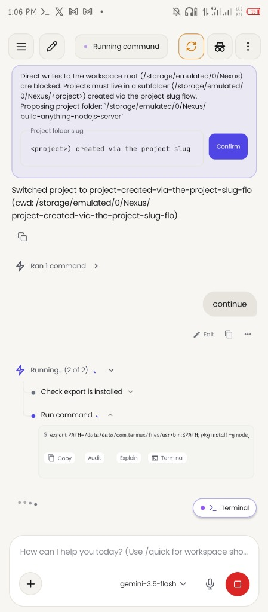
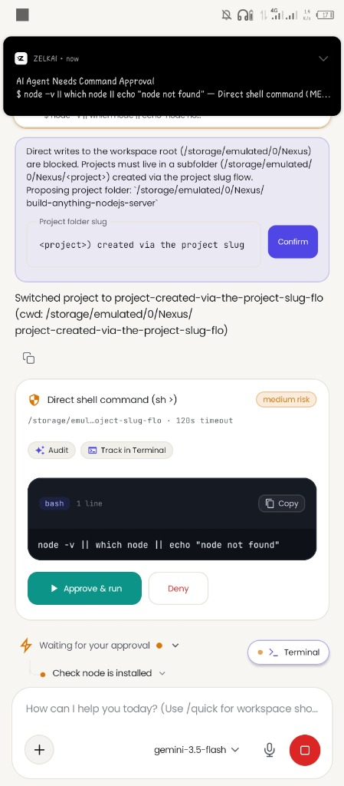
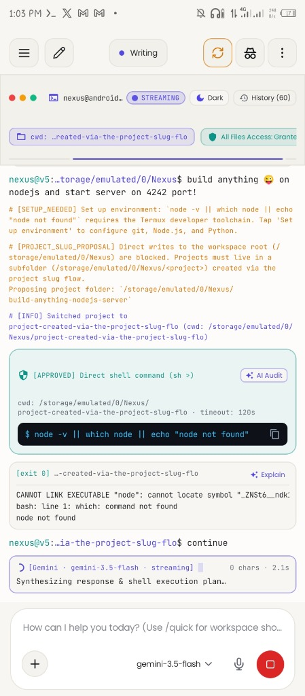
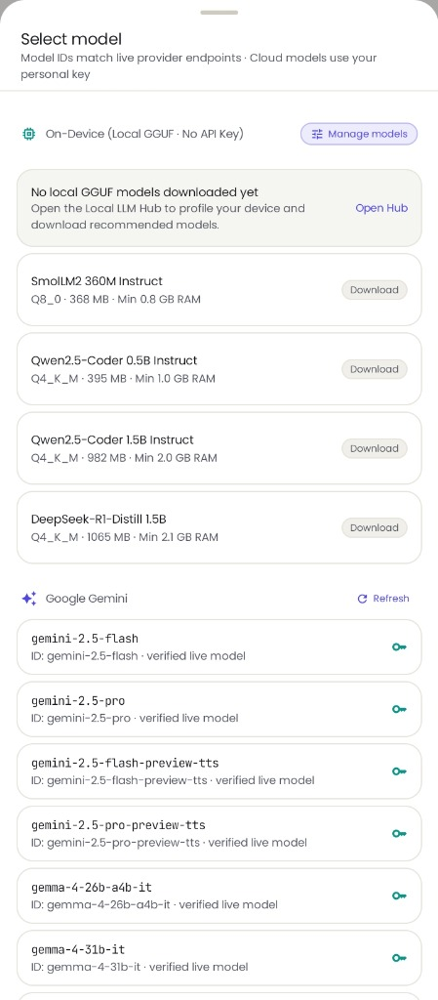
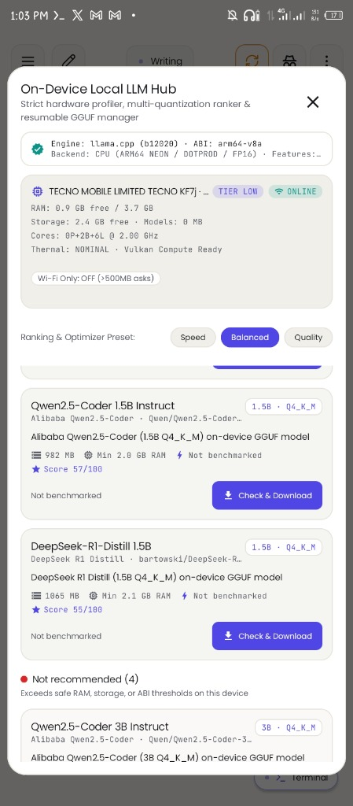

# ZELKAI

**Autonomous Linux Shell & Multi-Provider AI Coding Assistant for Android**

ZELKAI (`com.zelkai.devagent` is a native Android developer agent built with Kotlin, Jetpack Compose, and an embedded `llama.cpp` runtime. It combines cloud LLM providers (Google Gemini, Anthropic Claude, and OpenAI) with on-device ARM64 GGUF inference, a local Linux shell and Termux execution backend, background job management, and local-first transcript persistence.

| Specification | Details |
| :--- | :--- |
| **Application Name** | ZELKAI (formerly Nexus Agent v5) |
| **Android Package ID** | `com.zelkai.devagent` |
| **Platform** | Android (`minSdk = 24`, `compileSdk = 36`, `targetSdk = 36`) |
| **Target Native ABI** | `arm64-v8a` (16 KB ELF page-size aligned) |
| **On-Device LLM Engine** | `llama.cpp` pinned at release tag `b12020` |
| **UI Framework** | Jetpack Compose (Material 3) |
| **Repository** | `https://github.com/PAIN-hub/zelkai.git` |
| **Download Page** | [https://pain-hub.github.io/zelkai/](https://pain-hub.github.io/zelkai/) (`docs/index.html`) |
| **Author** | `beely` ([PAIN-hub](https://github.com/PAIN-hub)) |
| **Sponsor** | [GitHub Sponsors](https://github.com/sponsors/PAIN-hub) |

---

## Screenshots

| Agent Timeline & Live Execution | Command Approval Gate | Integrated Terminal |
| :---: | :---: | :---: |
|  |  |  |

| Multi-Provider Model Switcher | On-Device Local LLM Hub (`llama.cpp b12020`) |
| :---: | :---: |
|  |  |

---

## Core Capabilities

### 1. Multi-Provider Cloud AI Engine

Implemented in `MultiPlatformAiEngine.kt` and `GenerationOutcome.kt`, ZELKAI supports streaming responses from **Google Gemini**, **Anthropic Claude**, and **OpenAI** using user-supplied API keys stored locally via `UserApiKeyStore.kt`.

- **Unified Streaming SSE Pipeline**: Handles chunked OpenAI `tool_calls` and `reasoning_content`, Anthropic `tool_use`, `thinking_delta`, `input_json_delta`, `message_delta`, and `error` events, and Gemini `thought` parts, `finishReason`, and `blockReason` metadata.
- **Long-Response & Breakdown Reliability**: Uses a 120-second HTTP read timeout, a 180-second stream guard that preserves partial output, and non-blocking coroutine retries on HTTP `429`, `5xx`, and pre-first-byte timeouts.
- **Structured Outcome Classification**: Distinguishes normal completions from `BudgetConsumedByReasoning`, `Blocked`, `PromptTooLong`, and `ParseError` states so empty or truncated generations surface actionable feedback instead of silent failures.
- **Zelkai Identity & Personas**: Ships with a Zelkai model-facing system prompt (`NexusModels.kt`), built-in developer personas (`NexusPersonalizationStore.kt`), and automatic migration for untouched legacy prompts.

### 2. On-Device Local LLM Runtime (`llama.cpp`)

ZELKAI compiles and bundles `llama.cpp` (pinned at tag `b12020`, commit `0ec4027a2a0183de87c007069adddc06e665f7de`) as the `:llama` Gradle module (`third_party/llama.cpp/examples/llama.android/lib`) with minimal JNI/Kotlin overlays in `scripts/llama-android-lib-overlay/`.

- **Release-Optimized ARM64 Native Build**: Compiles `libai-chat.so`, `libllama.so`, and `libggml*.so` in CMake `Release` (`-O3`) mode for `arm64-v8a` with 16 KB page alignment (`-Wl,-z,max-page-size=16384`) and native networking disabled (`LLAMA_OPENSSL=OFF`, `LLAMA_CURL=OFF`).
- **Model Lifecycle & Memory Safety**: `LlamaEngine.kt` and `LocalLlmManager.kt` enforce GGUF header/size validation, device RAM load guards, multi-byte UTF-8 boundary decoding, `<think>...</think>` stream parsing, `onTrimMemory` eviction, and idle unloading.
- **Hardware Profiling & Downloads**: `DeviceProfiler.kt`, `InferenceOptimizer.kt`, `RecommendationEngine.kt`, and `ModelDownloadService.kt` manage GGUF downloads with SHA-256 verification and real hardware benchmarking.
- **Non-Blocking Startup**: `EngineProvider.initialize` runs asynchronously on `Dispatchers.IO` and falls back to `StubEngine` if native libraries are unavailable, preventing cold-start freezes.

### 3. Autonomous Linux Shell, Termux & Background Jobs

- **Dual Execution Backends**: Executes workspace commands through the built-in Android toybox shell (`LocalShellBridge.kt`) or **Termux** (`TermuxBackend.kt`, `TermuxDiagnostics.kt`) with persistent working directory tracking (`WorkspaceProjectManager.kt`).
- **Background Job Manager**: `JobManager.kt` tracks long-running development processes (such as local web servers, watchers, or builds) through `start_job`, `job_status`, `job_logs`, and `stop_job`.
- **On-Device WebView Preview**: `NexusJobsAndPreviewSheet.kt` provides a local loopback preview sheet for inspecting running local servers directly inside the app.

### 4. Security & Privacy Architecture

- **Automatic Secret Redaction**: `NexusToolAndRedactor.kt` scrubs tokens, keys, and sensitive credentials before display, storage, or crash reporting.
- **Command Risk Classification & Approval Gate**: `CommandExecutionPolicy.kt` classifies shell commands by risk tier and enforces explicit user approval before executing potentially destructive operations.
- **Redacted Crash Recovery**: `MainActivity.kt` installs an uncaught exception handler that redacts secrets, saves a safe crash summary locally, and presents a recovery banner on the next launch.
- **Authentication & Cloud Guardrails**: Supports Firebase Authentication (Google Sign-In via Android Credential Manager, Email/Password, and offline Guest fallback), Firebase App Check (`AppCheckHelper.kt`), and scoped Firestore rules (`firestore.rules`).
- **Zero Sensitive Logging**: Prompts, model outputs, user emails, and API keys are never written to application logs.

### 5. Local-First Persistence & Sync Control

- **Local Transcript Store**: `LocalTranscriptStore.kt` persists sessions and timeline entries as JSON on-device with isolated session IDs so conversations remain immediately available offline.
- **Throttled Cloud Sync & Circuit Breaker**: `NexusRepository.kt` and `FirestoreErrorHandler.kt` throttle background Firestore synchronization to 60-second intervals with circuit-breaker protection against repeated network or permission failures, paired with a manual **Sync** trigger in the UI.

### 6. Modern UI & UX Design System

- **Light-First Material 3 Theme**: Defaults to a clean Light/White Mode palette with Light, Dark, and System theme switching (`ui/theme/Color.kt`, `Theme.kt`, `Shape.kt`, `Type.kt`).
- **Monochrome Iconography & Typography**: Uses custom monochrome vector icons in `LucideIcons.kt` paired with **Poppins** for interface text and **JetBrains Mono** for code blocks and terminal output.
- **Agent Timeline & Composer**: `AgentTimelineComponents.kt`, `NexusMainScreen.kt`, and `ChatComposer.kt` render collapsible **Thought Process** blocks, grouped tool-execution steps, response action controls (Copy, Regenerate, Feedback), and a responsive bottom-pinned composer (`adjustResize` + `imePadding`).

---

## Project Structure

| Path | Purpose |
| :--- | :--- |
| `app/src/main/java/com/example/MainActivity.kt` | Application entry point, async engine initialization, App Check setup, and redacted crash handler |
| `app/src/main/java/com/example/data/local/` | Local-first JSON transcript persistence (`LocalTranscriptStore.kt`) |
| `app/src/main/java/com/example/data/model/` | Core models, Zelkai default system prompt, and timeline/session schemas (`NexusModels.kt`) |
| `app/src/main/java/com/example/data/repository/` | Firestore synchronization, throttling, and offline-first repository (`NexusRepository.kt`) |
| `app/src/main/java/com/example/domain/` | Cloud AI SSE engine, `llama.cpp` bridge, shell/Termux backends, job manager, redactor, and policies |
| `app/src/main/java/com/example/ui/` | Jetpack Compose screens, Agent Timeline, Settings, Local LLM Hub, Auth, and Material 3 theme |
| `app/src/test/java/com/example/` | JVM unit tests covering AI reliability, identity, local runtime guards, timeline, and UI tokens |
| `third_party/llama.cpp/` | Vendored `llama.cpp` (`b12020`) mapped to the `:llama` Gradle module in `settings.gradle.kts` |
| `scripts/` | Local pre-push guard (`pre-push-check.sh`), CI watcher (`gh-watch-and-pull-apk.sh`), and `:llama` overlay |
| `.github/workflows/android-cli.yml` | 5-stage GitHub Actions CI pipeline for native/Kotlin diagnostics, unit tests, and APK artifacts |
| `firestore.rules` | Cloud Firestore security rules |
| `instruction.md` | Detailed build, keystore, NDK, 16 KB alignment, wireless ADB, and CI instructions |
| `docs/` | Deep technical guides for Firebase, `llama.cpp`, runtime testing, and audits |

---

## Quick Start

### Prerequisites

| Requirement | Version / Details |
| :--- | :--- |
| **JDK** | Java 17 or 21 (OpenJDK / Temurin) |
| **Android SDK** | `compileSdk = 36` (minor API level 1), `minSdk = 24`, `build-tools` `35.0.0+` |
| **Android NDK** | `27.2.12479018` (Side-by-Side) |
| **CMake** | `3.22.1` |
| **Firebase Config** | `app/google-services.json` configured for `com.zelkai.devagent` (see [docs/FIREBASE_SETUP.md](docs/FIREBASE_SETUP.md)) |
| **Secrets File** | Optional `.env` copied from `.env.example` (managed by the Secrets Gradle Plugin) |

### Clone & Build

```bash
# 1. Clone the repository
git clone https://github.com/PAIN-hub/zelkai.git
cd zelkai

# 2. Vendor llama.cpp at pinned tag b12020 and apply the ZELKAI overlay (if not already present)
mkdir -p third_party
git clone --depth 1 --branch b12020 https://github.com/ggml-org/llama.cpp.git third_party/llama.cpp
cp -r scripts/llama-android-lib-overlay/* third_party/llama.cpp/examples/llama.android/lib/

# 3. Verify Firebase configuration and package ID guard
./gradlew verifyFirebaseConfig

# 4. Run JVM unit tests
./gradlew testDebugUnitTest

# 5. Build the Debug APK (output: app/build/outputs/apk/debug/app-debug.apk)
./gradlew assembleDebug
```

For Release APK signing, keystore generation, 16 KB ELF alignment checks, and wireless ADB logcat commands, see [instruction.md](instruction.md).

---

## Documentation Index

| Document | Description |
| :--- | :--- |
| [instruction.md](instruction.md) | Full build, keystore, native NDK/CMake, 16 KB alignment, wireless ADB, and CI instructions |
| [docs/FIREBASE_SETUP.md](docs/FIREBASE_SETUP.md) | Firebase project setup, Google Sign-In, SHA-1/SHA-256 fingerprints, and `google-services.json` verification |
| [docs/LLAMA_VERSION.md](docs/LLAMA_VERSION.md) | Pinned `llama.cpp` `b12020` commit metadata, build flags, and upgrade policy |
| [docs/LLAMA_PATCHES.md](docs/LLAMA_PATCHES.md) | Minimal JNI and Kotlin patches applied to the `:llama` Android library module |
| [docs/RUNTIME_TEST.md](docs/RUNTIME_TEST.md) | Physical ARM64 device verification checklist and logcat inspection guide |
| [docs/FEATURE_AUDIT.md](docs/FEATURE_AUDIT.md) | Feature capability audit across agent, shell, and local inference workflows |
| [docs/UX_COPY_AUDIT.md](docs/UX_COPY_AUDIT.md) | UI copy consistency and user-facing messaging guidelines |

---

## CI/CD & Developer Tooling

### GitHub Actions Pipeline (`.github/workflows/android-cli.yml`)

Every push or pull request on `master`, `main`, `feat/**`, or `fix/**` (as well as manual `workflow_dispatch`) executes a 5-stage diagnostic build on `ubuntu-latest` with JDK 21, Gradle caching, and `ccache` for `:llama`:

| Stage | Command / Action | Diagnostic Output |
| :--- | :--- | :--- |
| **Stage 1** | `./gradlew verifyFirebaseConfig` | Guards `com.zelkai.devagent` package ID and Web Client ID in `app/google-services.json` |
| **Stage 2** | `./gradlew :llama:assembleRelease` | Compiles ARM64 native `llama.cpp` (`b12020`); extracts C++/CMake errors into Job Summary on failure |
| **Stage 3** | `./gradlew :app:compileDebugKotlin --continue` | Extracts exact `^e:` Kotlin compiler diagnostics into Job Summary |
| **Stage 4** | `./gradlew testDebugUnitTest --continue` | Runs the JVM unit test suite and reports failing test entries |
| **Stage 5** | `./gradlew assembleDebug` + `zipalign -c -P 16` | Builds `app-debug.apk`, verifies 16 KB page alignment, and uploads the `zelkai-debug-apk` artifact |

### Local Pre-Push Check & Remote CI Watcher

```bash
# Fast local syntax, merge-conflict marker, and invariant guard (<1s)
./scripts/pre-push-check.sh

# Optional local Kotlin compile check with narrowed e: error output
./scripts/pre-push-check.sh --compile

# Tail the latest GitHub Actions run for the current branch and download dist/app-debug.apk on success
./scripts/gh-watch-and-pull-apk.sh
```

---

## Unit Test Coverage

Run the JVM test suite with `./gradlew testDebugUnitTest`:

| Test Suite | Coverage Area |
| :--- | :--- |
| `EmptyResponseReliabilityUnitTest.kt` | Cloud SSE parsing for OpenAI/Anthropic/Gemini tool calls, reasoning blocks, and retries |
| `GenerationOutcomeUnitTest.kt` | Reasoning-only budget exhaustion, blocked responses, and `<think>` display stripping |
| `LlamaRuntimeUnitTest.kt` | `LlamaEngine` load guards, GGUF validation, UTF-8 streaming, memory trim, and error mapping |
| `RamPolicyUnitTest.kt` | On-device RAM allocation thresholds and model safety guardrails |
| `ZelkaiIdentityUnitTest.kt` | Zelkai system prompt identity, built-in personas, and legacy prompt migration |
| `TurnTimelineUnitTest.kt` | Turn grouping, collapsible thought blocks, and tool-step timeline assembly |
| `TopBarStatusUnitTest.kt` | Agent status labels and top-bar state transitions |
| `UiDesignSystemUnitTest.kt` | Light-first theme defaults, color tokens, and typography/shape invariants |
| `NexusRepositoryRuleTest.kt` | Repository persistence and Firestore rule alignment |

---

## Contributing & Security Invariants

Contributions, bug reports, and pull requests are welcome at [PAIN-hub/zelkai](https://github.com/PAIN-hub/zelkai).

When modifying the codebase, keep the following architectural invariants intact:

- Do not weaken or bypass secret redaction in `app/src/main/java/com/example/domain/NexusToolAndRedactor.kt`.
- Do not weaken Firestore access rules in `firestore.rules` or bypass the command approval gate.
- Do not alter the core shell bridge (`LocalShellBridge.kt`) or terminal interface (`TerminalInterface.kt`) contracts without verifying approval-gate enforcement.
- Run `./scripts/pre-push-check.sh` before pushing changes.

---

## Author & Sponsorship

Created and maintained by **beely** ([https://github.com/PAIN-hub](https://github.com/PAIN-hub)).

If ZELKAI helps your mobile development workflow, consider supporting ongoing development through [GitHub Sponsors](https://github.com/sponsors/PAIN-hub).

---

## License

ZELKAI is dual-licensed under the **MIT License** and the **Apache License, Version 2.0**, at your option. Third-party `llama.cpp` source code in `third_party/llama.cpp` is licensed under the MIT License (see [docs/LLAMA_VERSION.md](docs/LLAMA_VERSION.md)).
